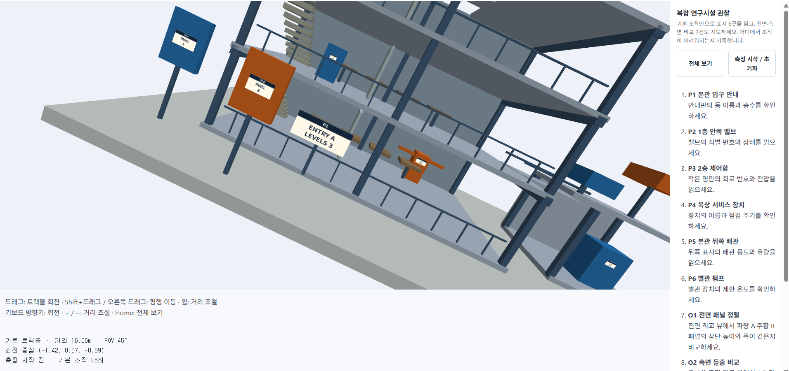
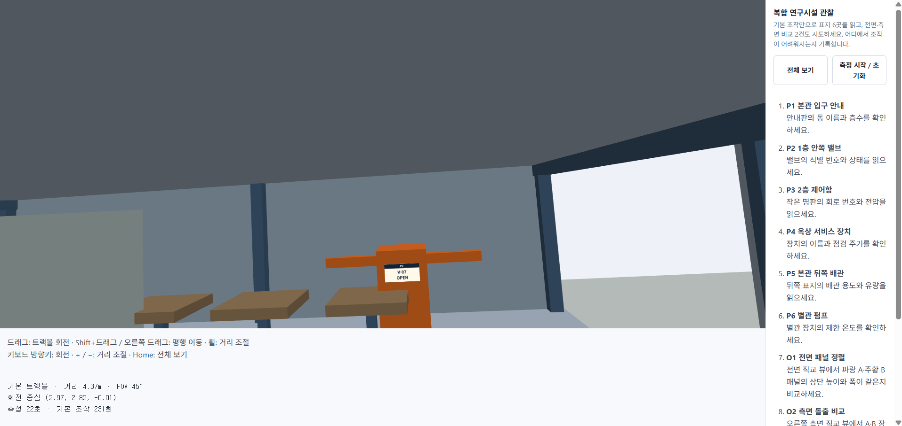
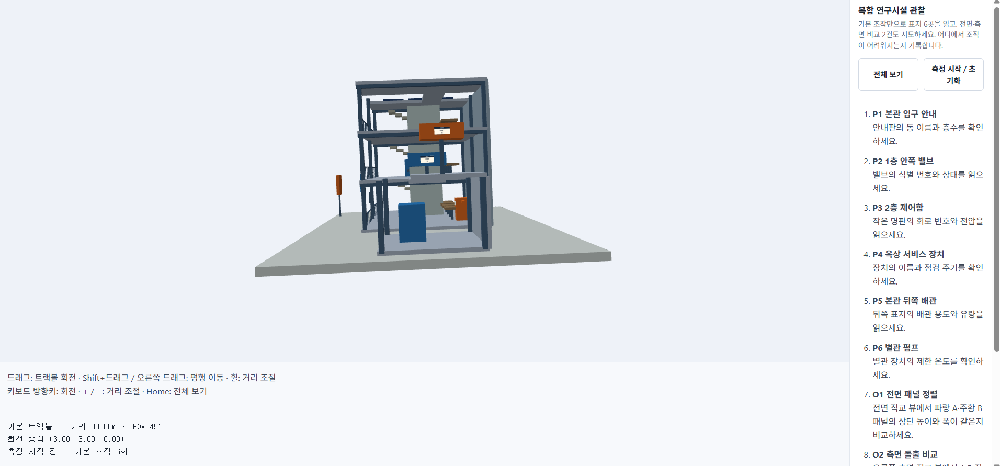

# 4주차 보고서

- 이름 : 김태민
- 저장소 : https://github.com/kimposong/cg-2026-solar/

## 실행 주소와 조작법

- 실행
    - [baseline 실행하기](https://kimposong.github.io/cg-2026-solar/week4/baseline/index.html) 
    - [improved 실행하기](https://kimposong.github.io/cg-2026-solar/week4/improved/index.html?v=20261006)

- improved 조작법
    - 모델 오른쪽의 P1~P6 목표 시점 보기 버튼을 누르면 명판과 주변 설비가 함께 보이는 정면 화면으로 이동합니다.
    - Q1·Q2 버튼은 전면·측면 비교 화면으로 이동합니다. Q2 옆 건물 외곽선 보기 버튼은 현재 시점을 유지한 채 본관은 청록색, 별관은 주황색 테두리만 켜고 끕니다.
    - 버튼으로 이동한 뒤에도 드래그 회전, Shift/오른쪽 드래그 평행 이동, 휠 확대를 계속 사용할 수 있습니다.

## 기본 버전의 지점별 관찰 결과와 불편 3개 이상

### 지점별 관찰 결과

| 지점 | 성공 / 실패 | 걸린 시간 | 불필요한 조작·되돌아가기 | 어려웠던 이유 |
| --- | --- | --- | --- | --- |
| P1 | 성공 | 5s | 67회 | 트랙볼 회전 과정에서 글씨를 읽기 위해 좌우로 틀어지지 않고 똑바르게 보기가 어렵다 |
| P2 | 성공 | 10s | 152회 | 1층을 보기 위해서 카메라 레벨을 1층과 같이 맞추는 과정이 어려움 |
| P3 | 성공 | 10s | 318회 | 초기 장면의 거리와 비교하여 읽어야하는 글씨의 크기가 매우 작아 관찰을 하기 위해서 필요이상으로 많은 조작이 들어감 |
| P4 | 성공 | 10s | 242회 | 비교적 편했음 |
| P5 | 성공 | 10s | 115회 | 초기 화면에서 드러나 있지 않아서 어떤 위치에 있는지 알아내는것이 쉽지 않음 |
| P6 | 성공 | 10s | 126회 | 트랙볼의 중심이 본관쪽으로 쏠려 있어서 확대하였을 때 별관 쪽으로 화면의 중심을 옮기는 과정이 번거로움 |
| Q1 | 성공 | 20s | 215회 | 초기 화면에서 두 간판의 높이를 비교하기 위해 정면에서 보는 화면으로의 전환이 쉼지 않음 트랙볼 조절을 세심하게 많은 조작이 필요함 |
| Q2 | 성공 | 20s | 189회 | Q1과 같이 초기 화면에서 측면으로의 화면 전환이 어려움 다수의 조작이 필요했음 |

### 불편사항

- 트랙볼 회전 과정에서 글씨를 읽기 위해 좌우로 틀어지지 않고 똑바르게 보기가 어려움
    - 

- 특정층을 보기 위해서 카메라 레벨을 해당층과 같이 맞추는 과정이 어려움
    - 

- 초기 화면에서 정면 or 정측면으로의 화면 전환이 어려움
    - 

## 사용자·관찰 목표, 대안 2개 이상의 스케치와 비교, 선택·조합한 이유

### 사용자 관찰 목표
- 일반적인 사용자가 빠르게 대표적인 위치를 한번의 조작으로 보는 것

### 대안

- 대상 클릭 후 집중보기
- 관찰 목적별 시점
- 층별 탐색

### 내가 선택한 방식

- 대안 3가지를 조합하여 대표적인 목표로 주어진 P1-6 , Q1 , Q2 를 적절한 위치에서 보여주는 버튼을 추가 해당 버튼을 클릭하면 한번에 해당 위치로 이동

## 실제 구현한 카메라·투영·입력 방식의 설명과 대표 코드

### 추가된 코드 설명

- 기본 트랙볼 포인터 회전 입력은 유지하고, `focus()` 카메라 프리셋을 추가 P1~P6,Q1~2의 명판 위치와 방향을 기준으로 시점을 설정
- Q2 화면에서 정확히 직교되는 위치에 카메라를 두게 되면서 두건물을 비교하기 용이하게 하기 위해서 두 건물의 외곽선을 표시하는 버튼을 추가

### 실제 코드

- focus 프리셋

```json
function focusQ2Buildings() {
    const aspect = canvas.clientWidth / Math.max(1, canvas.clientHeight);
    controls.focus([3.7, 4.6, 0], [1, 0, 0], 30, {
        orthographic: true,
        halfHeight: Math.max(5.15, 4.9 / aspect)
    });
}

button.addEventListener('click', () => {
    if (isComparison) {
        if (p.id === 'O2') {
            focusQ2Buildings();
        } else {
            controls.focus(p.position, p.viewDirection.map(value => -value), 30, {
                orthographic: true,
                halfHeight: 2.6
            });
        }
    } else {
        const sign = model.poi.find(item => item.id === p.id);
        const distance = {
            P1: 3.8, P2: 3, P3: 2.5, P4: 1.8, P5: 3, P6: 3.2
        }[sign.id];
        controls.focus(
            sign.position,
            [Math.sin(sign.yaw), 0, Math.cos(sign.yaw)],
            distance
        );
    }

    if (window.matchMedia('(max-width: 900px)').matches) {
        window.scrollTo({ top: 0, behavior: 'smooth' });
    }
});
```

- 외곽선 표시

```json
const buildingFrames = [
    { position: [0, 4.61, 0], size: [12.5, 9.7, 8.9], color: [0.02, 0.78, 0.92] },
    { position: [11, 1.65, 0], size: [5.5, 3.7, 5.5], color: [0.96, 0.28, 0.02] }
];
let showBuildingOutlines = false;

function drawOutline(frame) {
    const [x, y, z] = frame.position;
    const [sx, sy, sz] = frame.size;
    const thickness = 0.075;

    for (const yy of [-1, 1]) {
        for (const zz of [-1, 1]) {
            drawMesh(cube, matrix([x, y + yy * sy / 2, z + zz * sz / 2],
                [sx + thickness, thickness, thickness]), frame.color);
        }
    }
    for (const xx of [-1, 1]) {
        for (const zz of [-1, 1]) {
            drawMesh(cube, matrix([x + xx * sx / 2, y, z + zz * sz / 2],
                [thickness, sy + thickness, thickness]), frame.color);
        }
    }
    for (const xx of [-1, 1]) {
        for (const yy of [-1, 1]) {
            drawMesh(cube, matrix([x + xx * sx / 2, y + yy * sy / 2, z],
                [thickness, thickness, sz + thickness]), frame.color);
        }
    }
}

if (showBuildingOutlines) {
    gl.disable(gl.DEPTH_TEST);
    for (const frame of buildingFrames) drawOutline(frame);
    gl.enable(gl.DEPTH_TEST);
}

outlineButton.addEventListener('click', () => {
    showBuildingOutlines = !showBuildingOutlines;
    outlineButton.textContent = showBuildingOutlines
        ? '외곽선 숨기기'
        : '건물 외곽선 보기';
    outlineButton.setAttribute('aria-pressed', String(showBuildingOutlines));
    controls.state.actions++;
});
```


## 같은 8건에 대한 개선 전후 비교(전면·측면 직교 캡처 포함), 측정 한계, 추가 수정 전후의 기록

| 비교 항목 | 기본 버전 | 개선 버전 | 해석 |
| --- | --- | --- | --- |
| 관찰 완료 수 | 8/8 | 8/8 | 기존 버전도 여러번의 조작을 거치면 관찰 자체는 성공 가능 |
| 전체 관찰 시간 | 95s | 20s | 요구사항 8개를 원터치에 확인 할 수 있는 버튼을 추가함에 따라 추가적인 조작 없이 매우 빠른 시간안에 확인 가능 |
| 조작 부담 | 각 위치를 확인하는데 약 150회의 조작 | 약 15회 미만 | 확인해야하는 위치를 원클릭으로 확인 가능하기 때문에 조작 부담은 획기적으로 줄어듬 |
| 대표 불편 3개 | 위의 '불편사항' 확인 | --- | 해결됨 확인해야하는 요소를 미리 지정된 프리셋을 통해 한번에 해당 위치로 화면 위치를 변경 가능 |
| 새로 생긴 불편 | --- | 주어진 목표 외에 다른 부분을 확인하기 위해선 기존의 조금은 복잡한 조작을 이용해야함 | --- |

## 중요한 Copilot 제안과 본인의 판단 또는 직접 구현한 경우 검토한 대안

- 처음 개선안을 추가 하였을 때는 목표 위치를 AI가 임의로 정하도록 하였는데 결과 화면을 확인하였을 때 목표의 대부분이 '글씨를 읽기' 이기 때문에 카메라의 위치를 너무 확대한 프리셋을 제공하여서 목표 글씨가 해당하는 오브젝트까지 보이도록 카메라의 위치를 수정해 달라고 하였고 Q2를 확인할 때 정확히 직교하는 위치에 프리셋 화면을 두다보니 색이 같은 건물 두개를 비교하는데 어려움이 있었기 때문에 외곽선 버튼을 추가하여 확인하기 편하게 만듬
