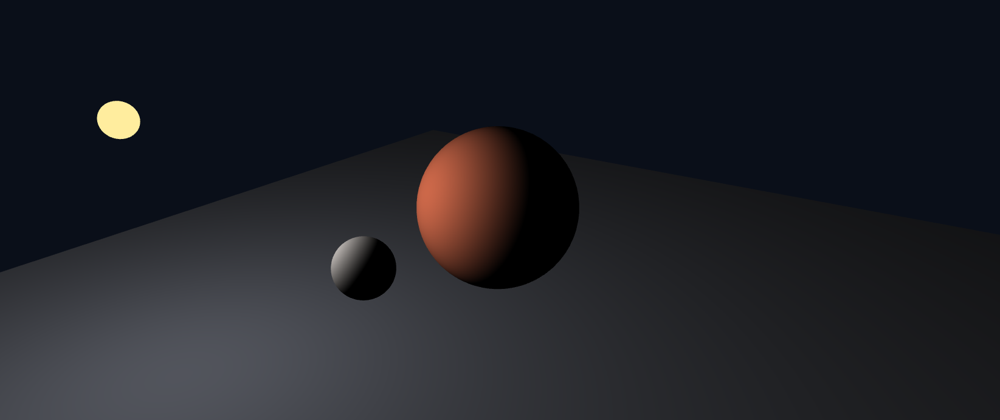
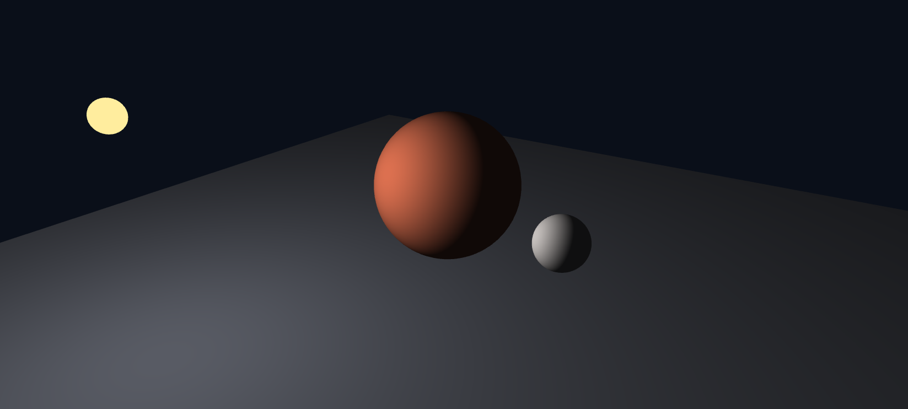
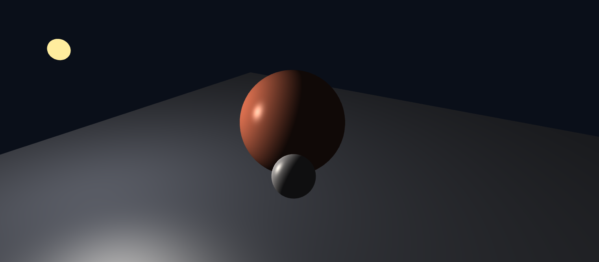
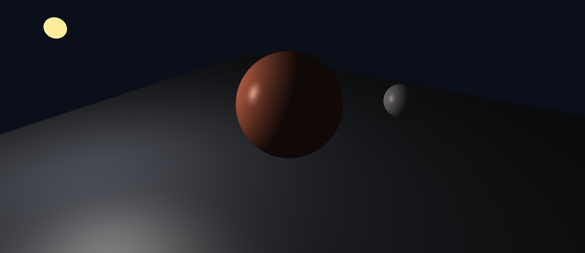
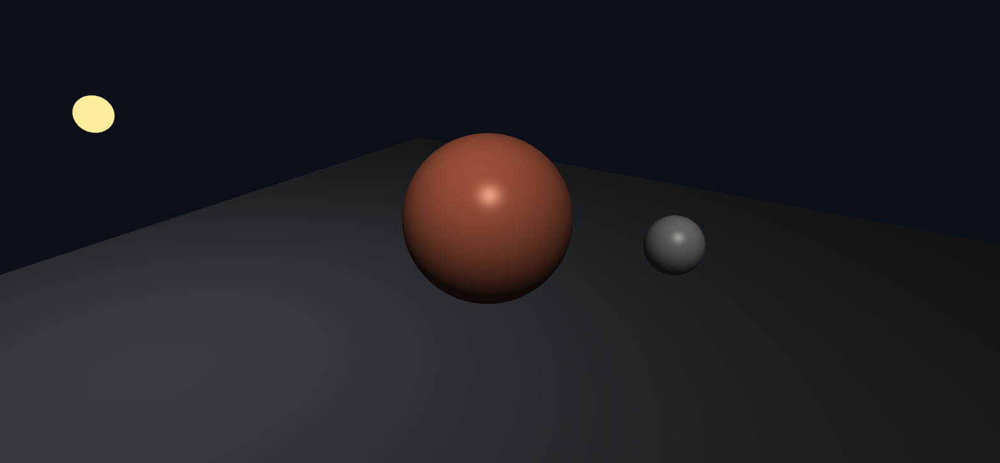
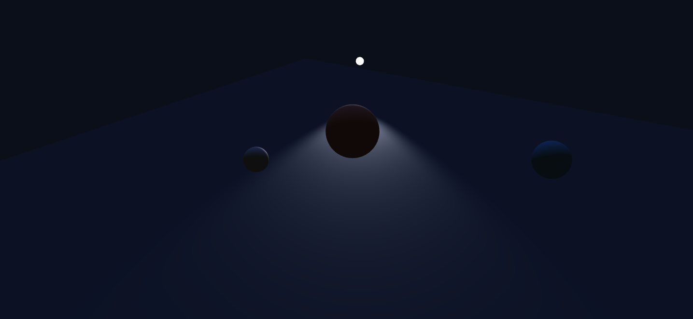
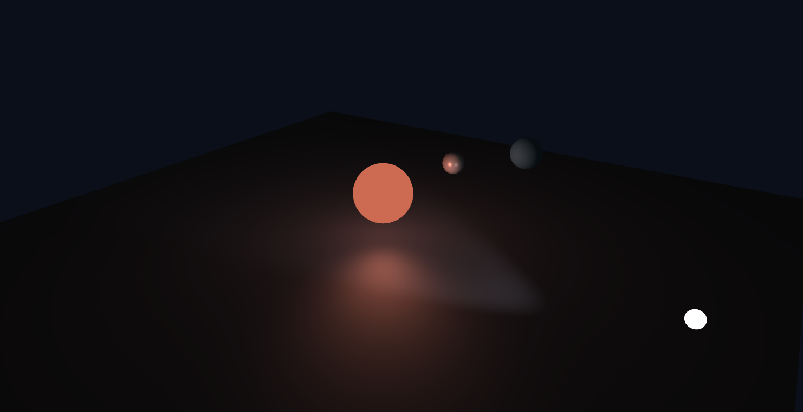
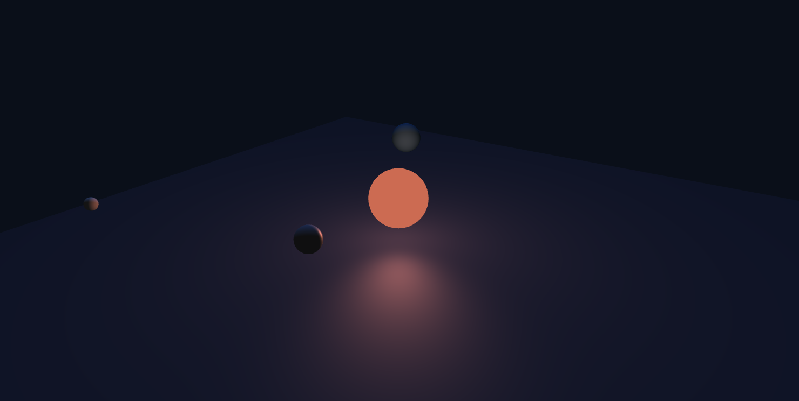
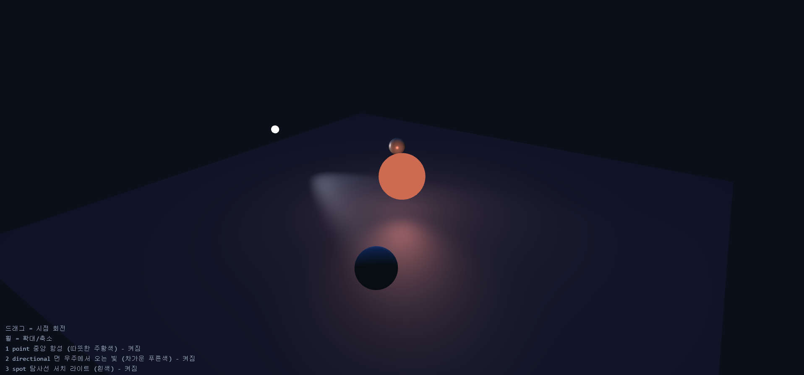

# 4주차 보고서

- 이름 : 김태민
- 저장소 : https://github.com/kimposong/cg-2026-solar/

## 실행 주소

- 실행
    - [task1 실행하기](https://kimposong.github.io/cg-2026-solar/week5/task1.html) 
    - [task2 실행하기](https://kimposong.github.io/cg-2026-solar/week5/task2.html)

## 실습 1

### 1-4 단계

- 1단계
    - 

- 2단계
    - 

- 3단계
    - 

- 4단계
    - 

### 단계 1의 max 제거 예측과 실제 결과

- 예측
    - `max`의 역할은 수를 최대 x까지로 제한하는 역할을 하는데 `max`가 0인 것을 보니 음수 값만을 갖게 하기 위한 안전장치인것 같기 때문에 `max`가 없어지면 내부값이 양수가 될 가능성이 생겨서 문제가 생길것 같다

- 결과
    - 직접 바꿔 보았을 때 큰 문제를 육안으로 확인하지는 못했으나 광원이 많아지는 등의 변화가 생긴다면 문제가 생길 수 있다는 결과를 AI에게 질문해 정보를 습득하게 되었다

### 5단계 비교

- 바꾸기 전 `mat3(uModel)`
    - 

- 바꾼 후 `uNormalMat`
    - 

### 단계 6 

- 변경 된 화면
    -  

- 바뀐 점
    - 바뀌기 전에는 중심 천체를 도는 천체중에 노란색 천체가 광원을 담당하면서 공전을 할 때 위치에 따라 다른 2개의 천체가 받는 빛의 위치가 변하는 과정을 고정된 화면 위치에서 관찰 할 수 있었다면, 변경된 후의 광원이 고정 위치로 바뀌게 되면서 일정한 방향에서 오는 빛을 받는 천체들만 관찰 하기 때문에 관찰 할 때 화면의 위치를 변경하여야만 다른 점을 확인 가능하다

## 실습 2

### 의도

- 간략화 한 태양계 느낌 중앙에 큰 광원 (태양) 이 있고 각기다른 표질의 행성이 주위를 돌고 있으며 외우주에서 오는 빛이 있고 인간이 만든 인공위성이 강한 빛을 비추며 돌아다님

### 방법

- 광원
    - 1번 point 중앙 항성 (따뜻한 주황색)
    - 2번 directional 외우주에서 오는 빛 (차가운 푸른색)
    - 3번 spot 탐사선 서치 라이트 (흰색)

- 행성
    - 1번 행성(회색) shininess 가 높고(20) ks수치도 높음(1)
    - 2번 행성(푸른색) shininess 가 낮고(5) ks수치도 낮음(0)

### 광원을 하나씩 끈 화면

- 1번
    - 

- 2번
    - 

- 3번
    - 

### 최종 화면

