# 6주차 보고서

- 이름 : 김태민
- 저장소 : https://github.com/kimposong/cg-2026-solar/

## 실행 주소

- 실행
    - [task1 실행하기](https://kimposong.github.io/cg-2026-solar/week6/task1.html)
    - [task2 실행하기](https://kimposong.github.io/cg-2026-solar/week6/task2.html)

- 조작법
    - 드래그 = 시점 회전, 휠 = 확대/축소, 시점 초기화 버튼 = 처음 시점으로 복귀
    - task1 은 오른쪽 패널의 `적용 단계` 로 TODO 1~5 를 하나씩 켜고 끄며 같은 시점에서 비교할 수 있습니다.
    - task2 는 `행성 자전` 을 끄면 행성이 멈춰서 같은 시점으로 비교 캡처를 할 수 있습니다.
    - 주소 뒤에 값을 붙이면 같은 조건으로 바로 열립니다. 예) `task1.html?stage=3` , `task2.html?spin=0&c1=50&c2=100&view=2`

## 실습 1

### 단계별 비교 (녹슨 금속, 같은 시점)

- 0단계 시작 코드 (회색 큐브 + Phong)
    - 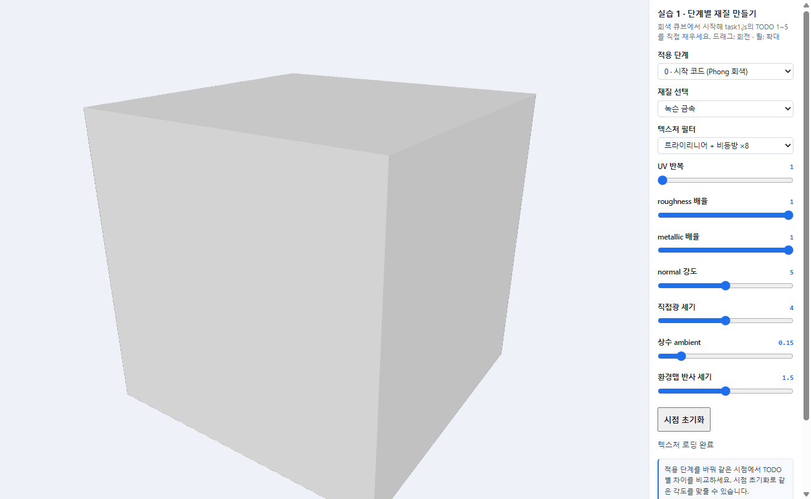

- 1단계 TODO 1 색 맵 읽기
    - 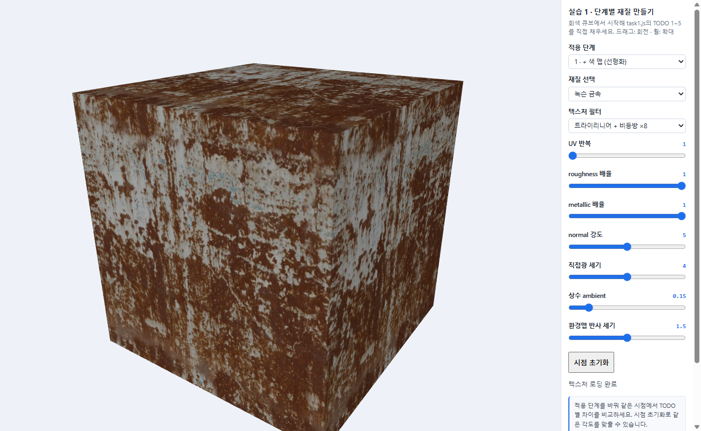

- 2단계 TODO 2 PBR 직접광
    - 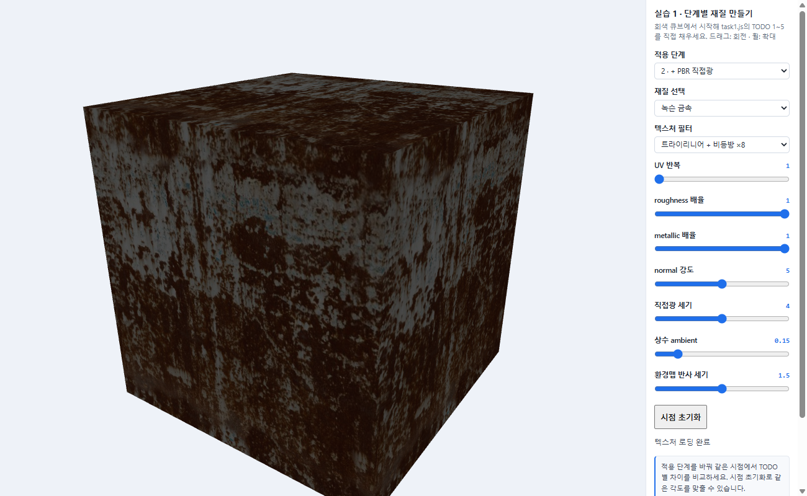

- 3단계 TODO 3 ARM 맵 읽기
    - 

- 4단계 TODO 4 노멀 맵
    - 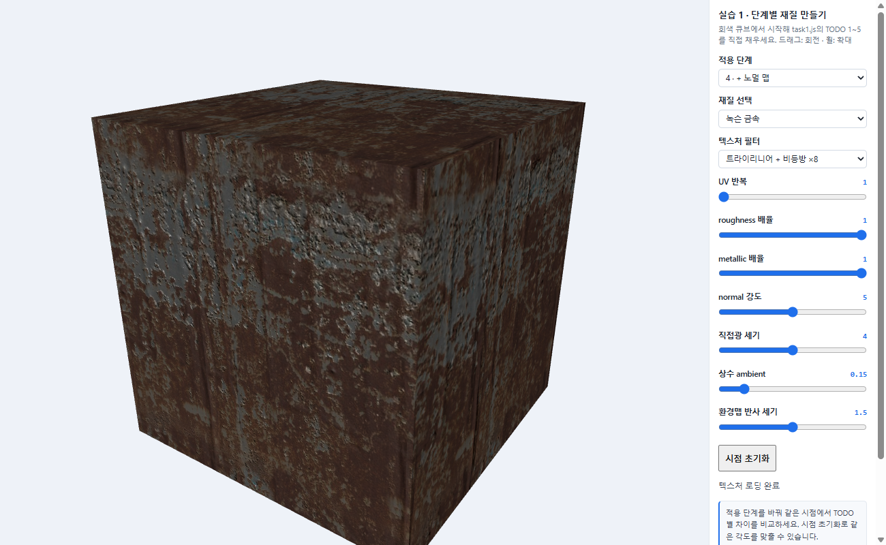

- 5단계 TODO 5 환경 반사
    - 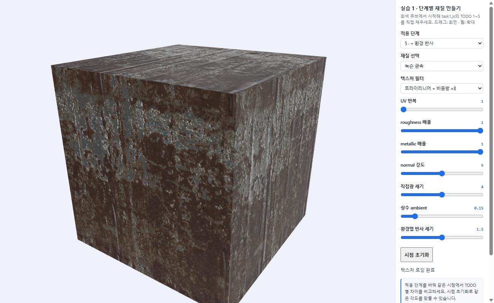

### 단계마다 바뀐 점

- 1단계
    - 색 맵은 사람이 보는 색(sRGB)으로 저장되어 있기 때문에 `srgbToLinear` 로 선형 값으로 바꾼 뒤 `uTint` 를 곱해서 사용했다. 회색 큐브에 녹 무늬가 생기지만 아직 Phong 이라 하이라이트는 재질과 관계없이 모두 같다.

- 2단계
    - Phong 두 줄을 `directPBR()` 호출로 바꿨다. D(GGX, α = r²), F(Schlick, F0 = mix(0.04, base, metal)), G(Smith-Schlick, k = (r+1)²/8) 를 곱하고 확산광은 `(1-F)(1-metal)` 만큼만 남겨서 에너지가 늘어나지 않게 했다.
    - 아직 ARM 을 읽지 않아서 슬라이더 값(rough = 1, metal = 1) 그대로 면 전체가 거친 금속이 되어 화면이 전체적으로 어둡다. 금속은 확산광이 0 이기 때문이다.

- 3단계
    - ARM 은 색이 아니라 수치 데이터이기 때문에 sRGB 변환을 하지 않고 R = AO, G = roughness, B = metallic 으로 그대로 읽었다. 슬라이더 값은 맵 값에 곱하는 배율로 사용했다.
    - AO 는 직접광에는 곱하지 않고 ambient 와 환경 반사에만 곱했다.

- 4단계
    - `dFdx/dFdy` 로 화면 공간에서 TBN 을 만들고 노멀 맵 값을 `RGB*2-1` 로 풀어서 법선을 바꿨다. 녹 덩어리가 튀어나와 보이는 음영이 생긴다.
    - normal 강도를 0 → 5 로 바꿔도 **큐브의 윤곽선은 그대로**였다. 노멀 맵은 조명 계산에 쓰는 법선 N 만 바꾸고 정점의 위치는 바꾸지 않기 때문이다.

- 5단계
    - `reflect(-V, N)` 방향을 `atan`, `asin` 으로 파노라마 UV 로 바꿔서 환경 이미지를 읽었다. 거칠수록 `textureLod` 의 밉 레벨을 높여 흐린 반사가 되게 했다.
    - 금속 부분에만 스튜디오 조명이 비쳐 밝아지고 녹 부분은 F0 가 약 0.04 라서 거의 변하지 않는다.

### 대표 코드 (TODO 2 directPBR)

```glsl
vec3 directPBR(vec3 N,vec3 V,vec3 L,vec3 base,float rough,float metal){
 rough=max(rough,0.045);
 vec3 H=normalize(L+V);
 float NL=max(dot(N,L),0.0), NV=max(dot(N,V),1e-4);
 float NH=max(dot(N,H),0.0), VH=max(dot(V,H),0.0);
 if(NL<=0.0) return vec3(0.0);
 float a=rough*rough, a2=a*a;
 float d=NH*NH*(a2-1.0)+1.0;
 float D=a2/(PI*d*d);                         // D: GGX
 vec3 F0=mix(vec3(0.04),base,metal);
 vec3 F=F0+(1.0-F0)*pow(1.0-VH,5.0);          // F: Schlick
 float k=(rough+1.0)*(rough+1.0)/8.0;
 float G=(NL/(NL*(1.0-k)+k))*(NV/(NV*(1.0-k)+k));  // G: Smith-Schlick
 vec3 spec=D*F*G/(4.0*NL*NV);
 vec3 kd=(1.0-F)*(1.0-metal);                 // 에너지 보존
 return (kd*base/PI+spec)*NL;
}
```

### 금속 부분과 녹 부분의 차이

- 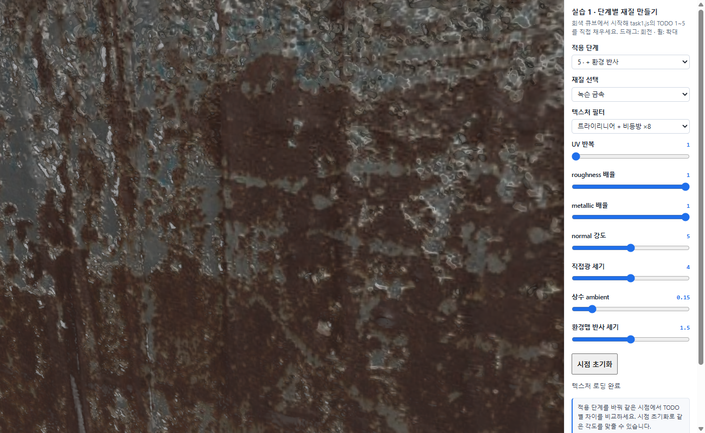

- 금속(철) 부분은 metallic 이 1 에 가까워 확산광이 없고 색이 반사로만 보이기 때문에 환경 이미지가 비친다.
- 녹 부분은 metallic 이 0 에 가깝고 roughness 가 높아서 확산광 위주이고 하이라이트가 넓고 흐리다.
- 같은 텍스처 한 장 안에서도 위치마다 ARM 값이 다르기 때문에 같은 빛을 받아도 다르게 보인다.

### 필터링 두 설정 비교 (UV 반복 10, 비스듬한 시점)

- NEAREST
    - 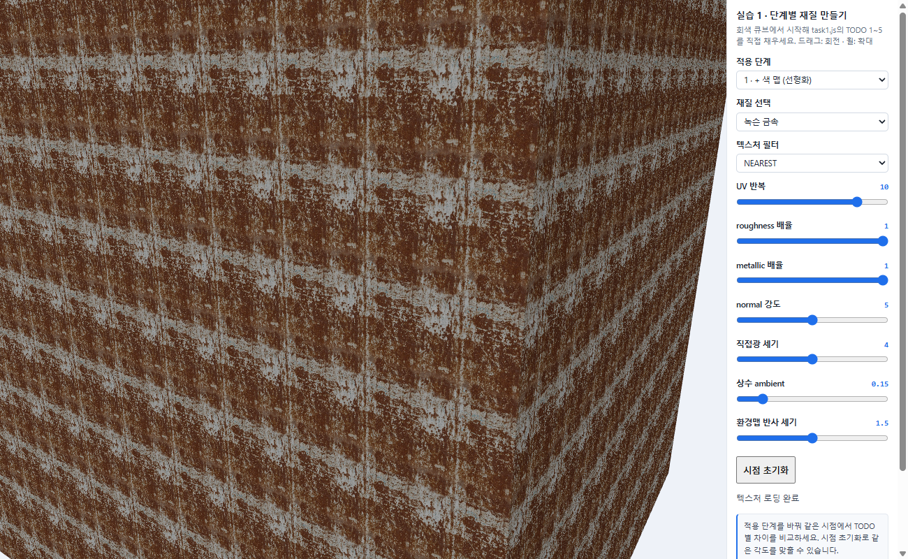

- 트라이리니어 + 비등방 ×8
    - 

- NEAREST 는 밉맵 없이 가장 가까운 텍셀 하나만 고르기 때문에 멀리 있는 윗면의 무늬가 자글자글하게 깨지고 시점을 움직이면 반짝거린다.
- 트라이리니어는 화면에서 차지하는 크기에 맞는 밉 레벨을 섞어서 먼 곳도 깨끗하다. 비등방 필터는 비스듬한 면에서 한쪽으로 길게 늘어난 영역을 여러 번 샘플링하기 때문에 트라이리니어만 쓸 때(`images/task1_filter_trilinear.png`)보다 먼 쪽이 덜 흐리다.

### 직접광, ambient, 환경맵을 모두 끄면?

- 모두 0
    - 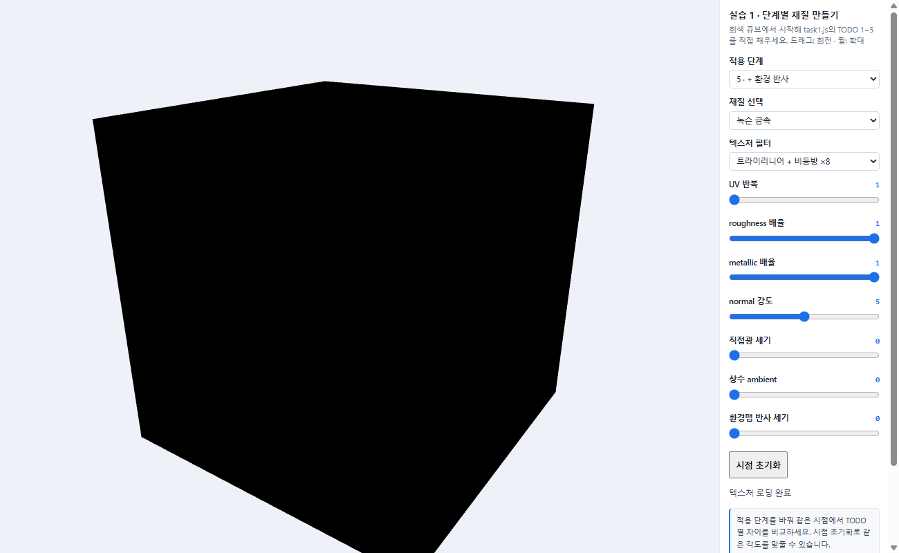

- 환경맵만 켬
    - 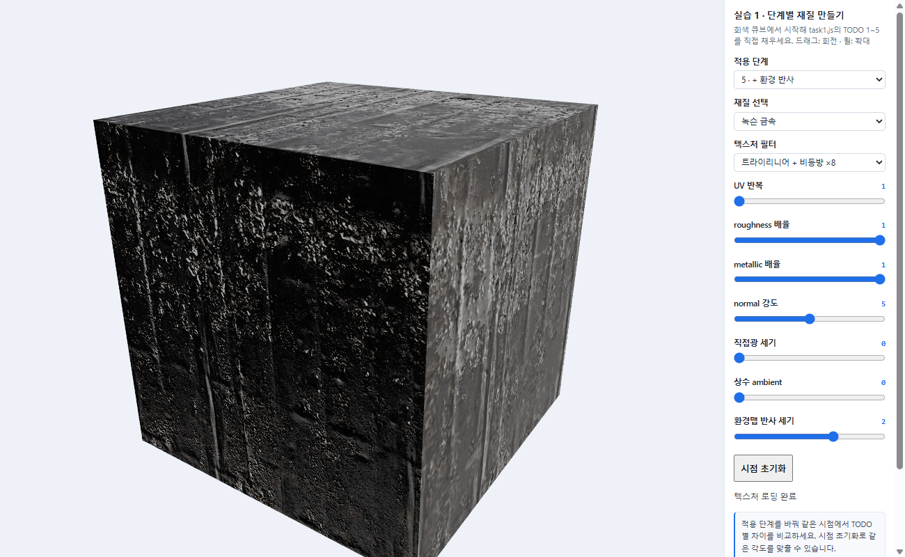

- ambient 만 켬
    - 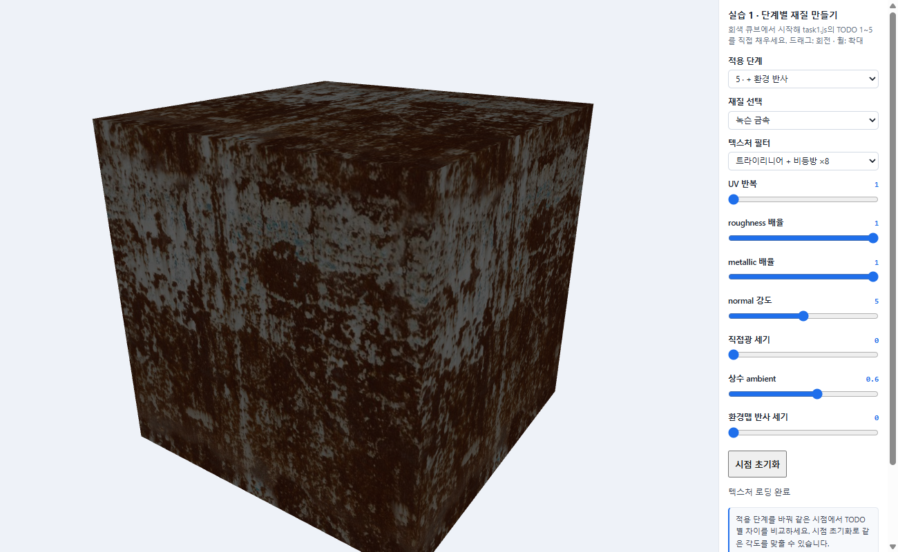

- 예측
    - 큐브는 스스로 빛나지 않기 때문에 빛을 모두 끄면 아무것도 보이지 않을 것 같다.

- 결과
    - 세 값이 모두 0 이면 큐브가 완전히 검게 보였다. 직접광을 꺼도 환경맵을 켜면 금속 부분만 반사로 밝게 보였고, 환경맵을 끄고 ambient 만 올리면 방향이 없는 균일한 빛만 남았다.

## 실습 2

### 의도 — 무엇을 만들고 싶었는가

- 어떤 행성을 만들려고 했습니까?
    - 철을 많이 품은 암석 행성인 「철광 행성」. 평소에는 마른 암석 표면이지만 태양에 가까워지면 뜨거워져서 녹이 슬고, 운석이 부딪히면 녹 아래에 있던 철이 드러난다.
- 왜 그렇게 정했습니까?
    - 실습 1 에서 녹슨 금속의 녹 부분과 철 부분이 roughness, metallic 값 차이만으로 완전히 다르게 보이는 것이 인상 깊어서, 그 두 재질이 원인에 따라 행성 위에서 바뀌는 모습을 만들고 싶었다.
- 예시와 무엇을 다르게 하려 했습니까?
    - 예시는 얼음 행성이지만 나는 **녹(거칠고 비금속)** 과 **드러난 철(매끈하고 금속)** 처럼 roughness 와 metallic 이 서로 반대 방향으로 바뀌는 두 재질을 골랐다. 장면 구도는 예시처럼 왼쪽에 태양 하나, 오른쪽에 행성 하나를 두고 공전 없이 자전만 하게 했다.

### 방법 — 어떻게 만들었는가

- 장면
    - 태양(발광체)과 철광 행성(UV 구) 두 개만 그린다. 태양은 점광원이고 빛의 세기는 `1 / (1 + 0.18·d²)` 로 거리에 따라 줄어든다.
    - 행성은 Y 축으로 자전한다. 법선은 `mat3(transpose(inverse(uModel)))` 로 변환했다.
    - 실습 1 의 `directPBR` 과 노멀 맵을 그대로 가져와서 `rock_boulder_dry` 텍스처를 기본 표면으로 사용했다.
    - 마스크는 `vLocal`(행성 기준 좌표)로 계산해서 행성이 자전해도 무늬가 표면에 붙어서 같이 돈다.

- 조건 1 · 항성 접근도 → 산화(녹) 마스크
    - 태양계 변수: 접근도가 오르면 행성 위치가 x = 1.65 → 0.55 로 태양 쪽으로 다가가고, 받는 빛이 최대 약 1.6 배까지 세진다.
    - 마스크: 위도 `abs(normalize(vLocal).y)` 를 기준으로 적도부터 극 쪽으로 녹이 번진다. 경계가 일직선이 되지 않도록 노이즈를 더했다.
    - 재질: 색은 녹슨 금속 텍스처를 주황 갈색 쪽으로 당긴 색, roughness 는 0.65 이상으로 높이고 metallic 은 0.05 로 낮췄다.

- 조건 2 · 운석 충돌 강도 → 크레이터 마스크
    - 행성 표면에 충돌 지점 16 개를 고르게 흩어 두고, 강도가 오르면 크레이터가 하나씩 나타나서 커진다.
    - 재질: 크레이터 안은 철 색(0.56), roughness 0.22, metallic 1 이고 노멀 맵 요철을 70 % 줄였다. 바깥 테두리는 분출물 느낌으로 어둡고 거칠게 했다.

- 두 마스크가 겹칠 때
    - 녹을 먼저 섞고 크레이터를 나중에 섞어서 겹치는 곳은 크레이터가 이긴다. 운석이 녹을 벗겨 냈다는 의미이다.

```glsl
// 규칙 1: 열 → 산화 마스크 (적도부터 번짐)
float rustMask(vec3 local,float heat){
 float lat=abs(normalize(local).y);                 // 0=적도, 1=극
 float n=fbm(local*3.0)-0.5;
 float front=heat*1.1-0.15-lat+n*0.3;
 return smoothstep(0.0,0.12,front)*smoothstep(0.0,0.06,heat);  // heat=0이면 정확히 0
}

// main() 에서 마스크를 재질에 연결
base=mix(base,rustCol,m1);   rough=mix(rough,rustRough,m1);  metal=mix(metal,0.05,m1);
base=mix(base,vec3(0.56,0.57,0.58),m2);  rough=mix(rough,0.22,m2);  metal=mix(metal,1.0,m2);
```

- 뜻대로 안 된 것과 고친 것
    - 처음에는 녹이 너무 빨리 번져서 접근도 70 % 만 되어도 행성 전체가 녹슬어 버렸다. 50 % 에서는 적도 띠, 100 % 에서는 거의 전체가 되도록 번지는 속도를 줄였다.
    - 처음에는 충돌 지점이 8 개뿐이라 한 시점에서 크레이터가 1~2 개만 보였다. 16 개로 늘리고 크기를 키운 뒤 바깥 테두리를 추가했다.
    - 예시 구도대로 카메라를 두었더니 행성의 밤쪽이 많이 보여서 녹 변화가 잘 보이지 않았다. 카메라를 태양 쪽으로 조금 돌리고 태양 밝기 기본값을 올렸다.

### 조건 1 항성 접근도 0 / 50 / 100 (조건 2 = 0)

- 0 %
    - 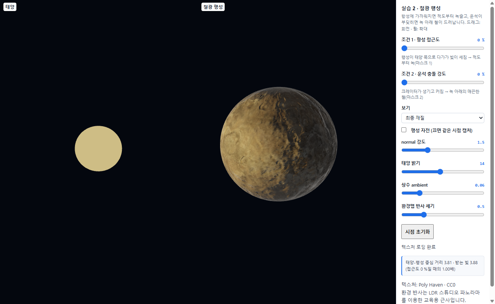

- 50 %
    - 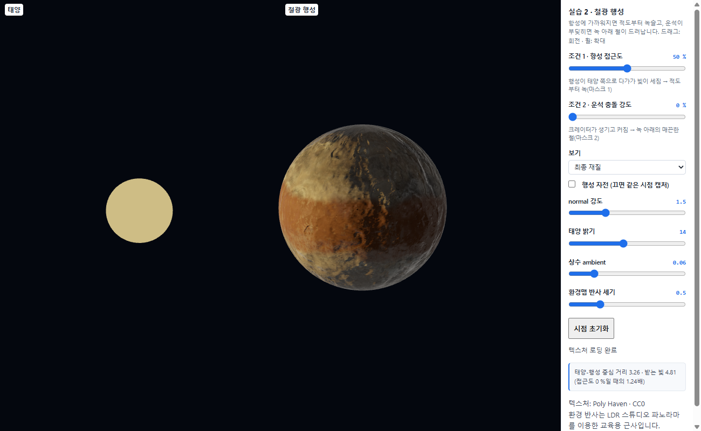

- 100 %
    - 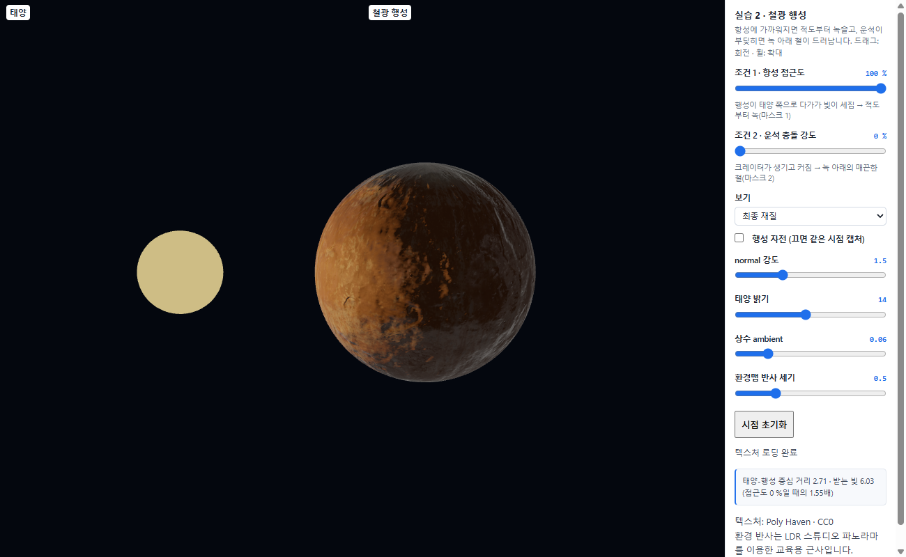

- 0 % 에서는 녹이 전혀 없고, 50 % 에서는 적도에 녹 띠가 생기고, 100 % 에서는 극 근처를 빼고 거의 전체가 녹슨다. 행성이 태양 쪽으로 다가가는 것과 낮 면이 밝아지는 것도 같이 보인다.

### 조건 2 운석 충돌 강도 0 / 50 / 100 (조건 1 = 50 % 고정)

- 0 %
    - 

- 50 %
    - 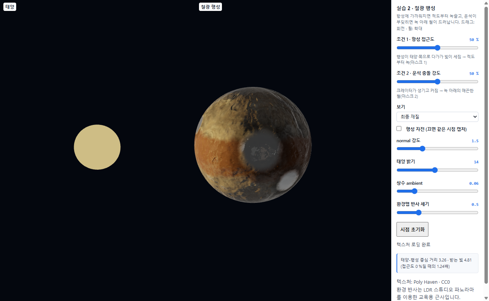

- 100 %
    - 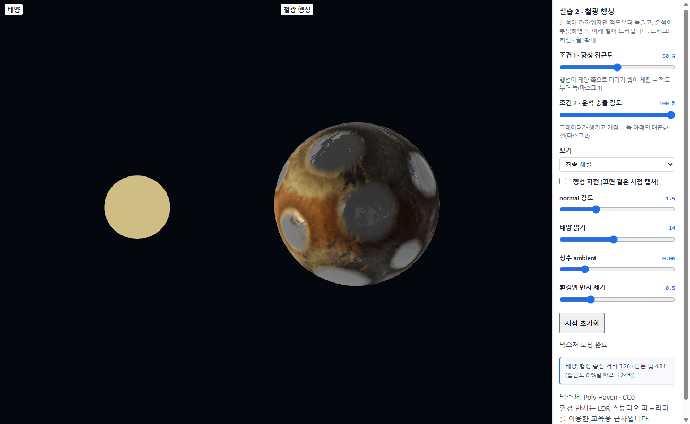

- 조건 1 을 고정했기 때문에 녹 띠는 그대로이고 크레이터만 늘어나고 커진다. 크레이터 안은 매끈한 금속이라 환경 이미지가 비쳐 밝은 회색으로 보인다.

### 마스크 회색조 보기 (조건 1 = 70 %, 조건 2 = 60 %)

- 마스크 1 산화
    - 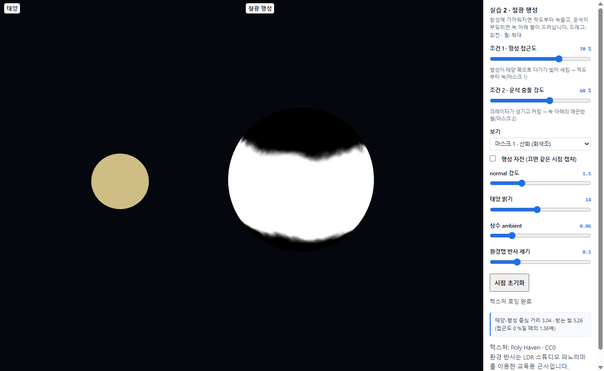

- 마스크 2 크레이터
    - 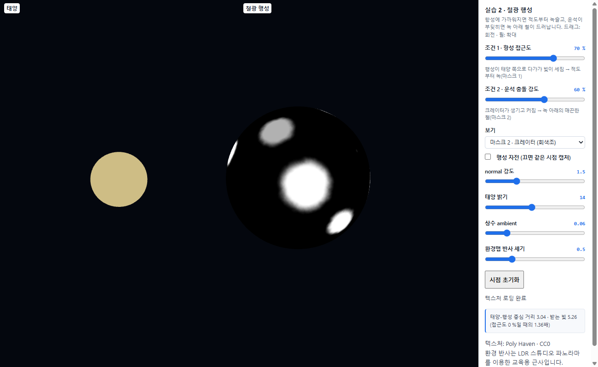

- 두 마스크 겹쳐 보기 (빨강 = 산화, 초록 = 크레이터)
    - 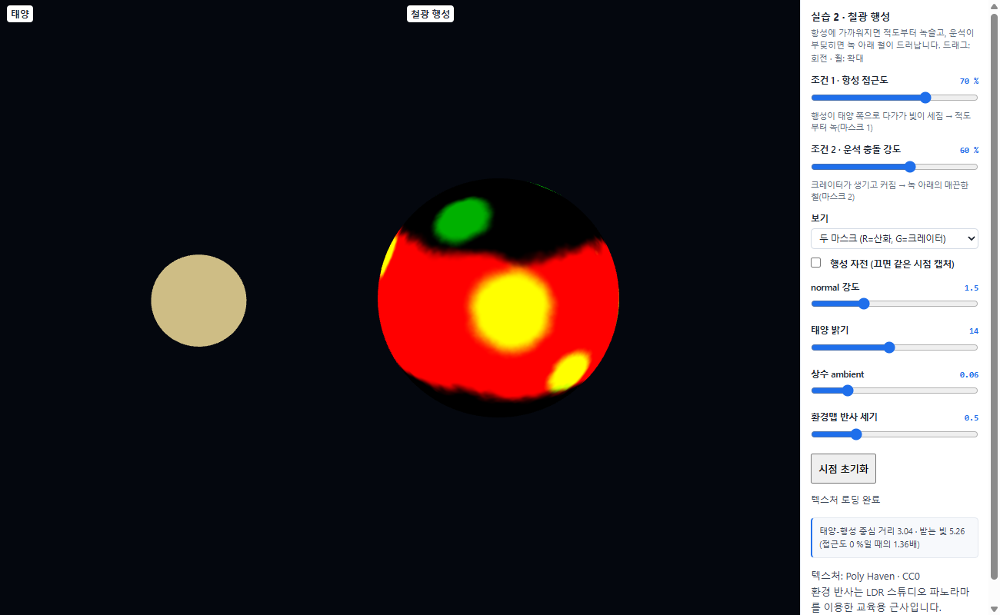

### 기본 행성과 바뀐 행성 비교 (같은 시점, 같은 빛)

- 기본 (마스크 끔)
    - 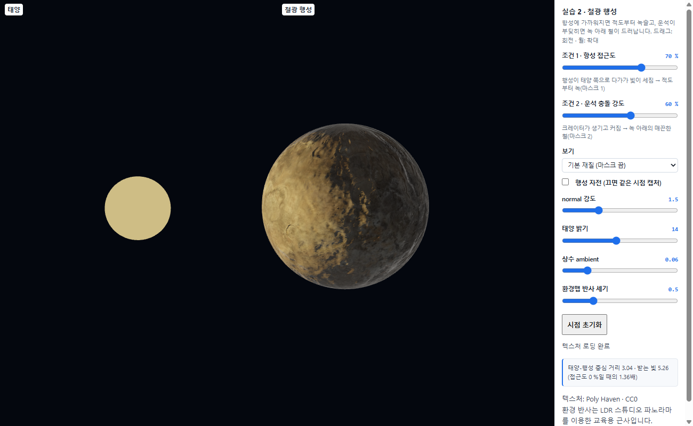

- 바뀐 행성
    - 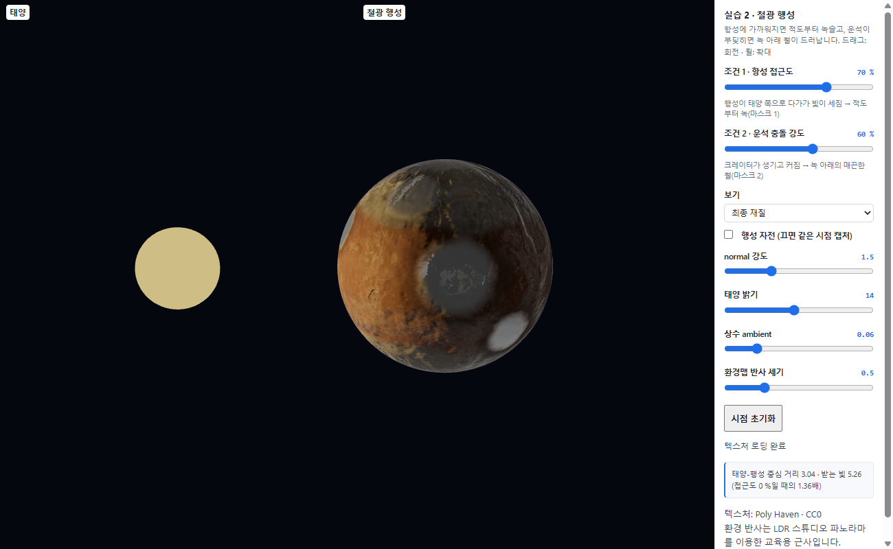

- 색만 바뀐 것이 아니라 녹 부분은 하이라이트가 사라지고 거칠어졌고, 크레이터 부분은 금속 반사가 생겼다. 행성이 자전해서 빛을 받는 방향이 바뀌면 크레이터의 반사만 크게 달라지고 녹은 거의 변하지 않는다.

## 텍스처 출처

- 모두 Poly Haven, CC0-1.0 (자세한 주소는 `assets/week06/sources.json`)

| 파일 | 사용한 곳 | 채널 / 규약 |
| --- | --- | --- |
| rock_boulder_dry (Diffuse, nor_gl, arm) | 실습 1 돌, 실습 2 기본 암석 | ARM (R = AO, G = roughness, B = metallic), 노멀은 OpenGL 규약(nor_gl) |
| rusty_metal_04 (Diffuse, nor_gl, arm) | 실습 1 녹슨 금속, 실습 2 녹 색과 거칠기 | ARM, nor_gl |
| wood_planks (Diffuse, nor_gl, arm) | 실습 1 나무 | ARM, nor_gl |
| studio_small_09 (tonemapped JPG) | 환경 반사 | 등장방형 LDR 파노라마 |

