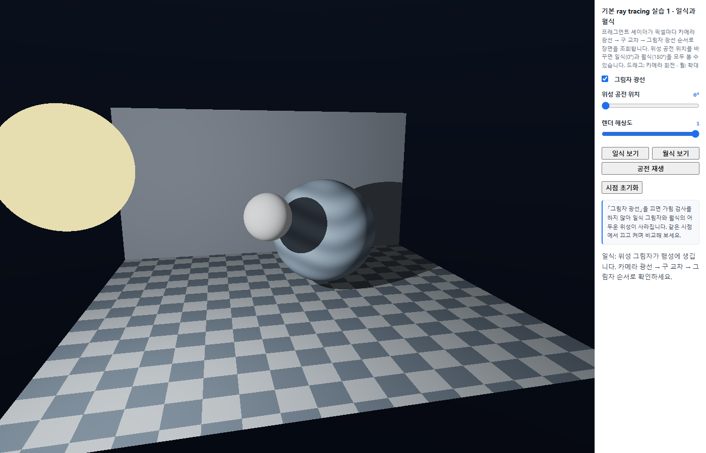
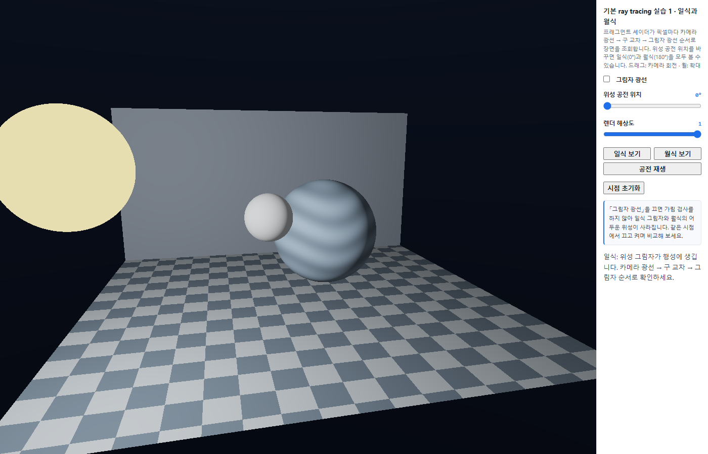
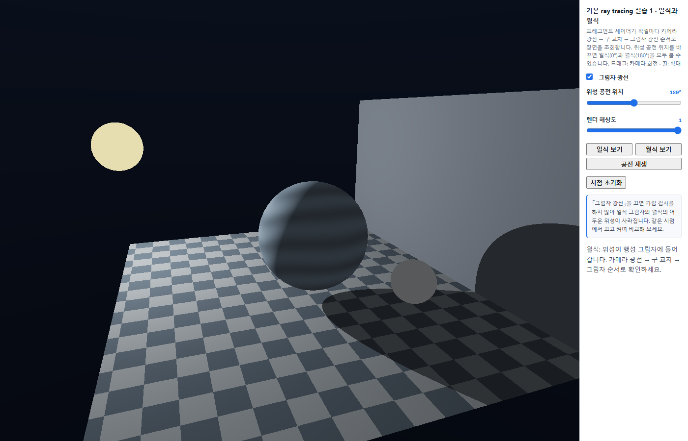
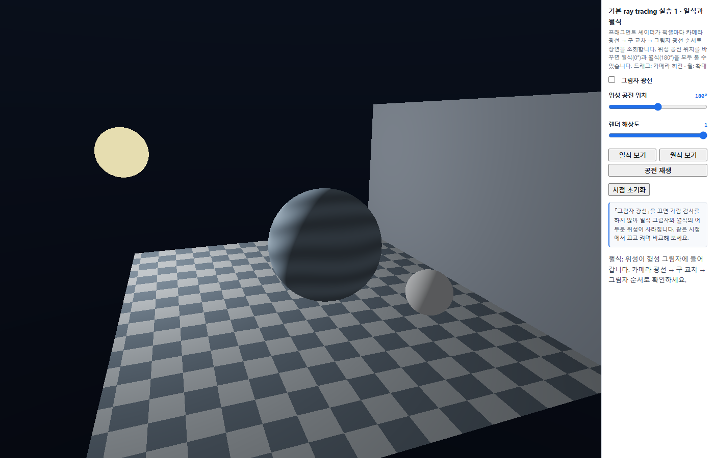
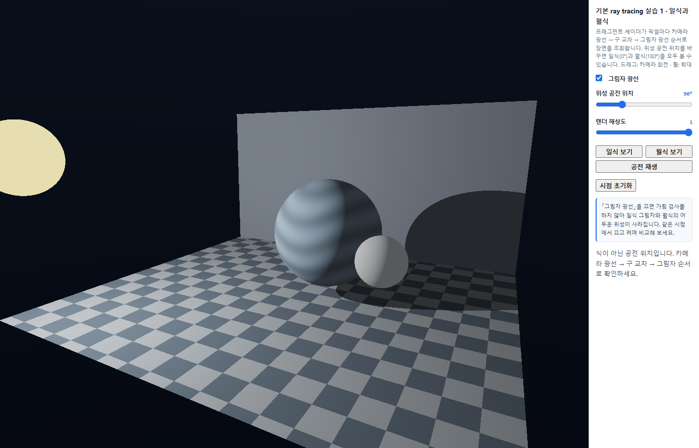
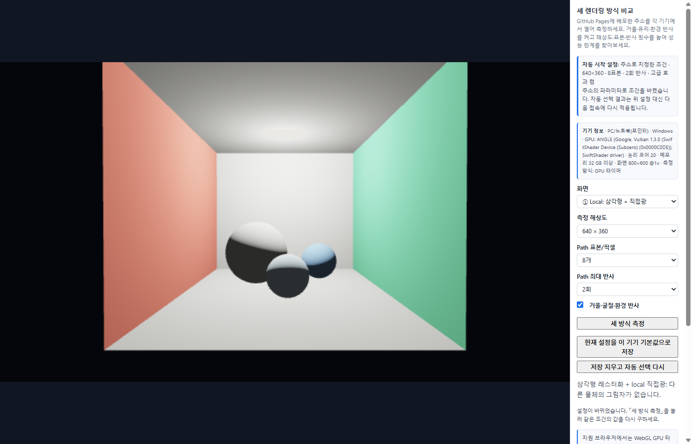
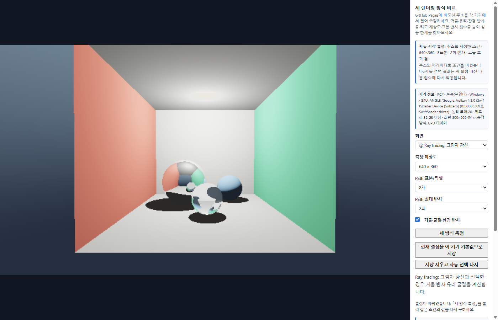
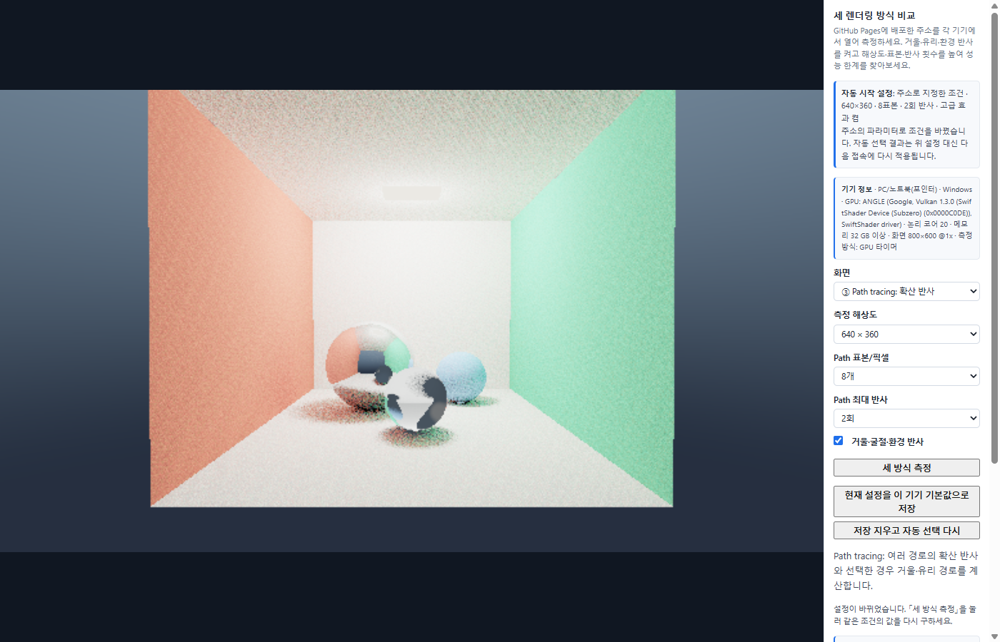

# 7주차 보고서

- 이름 : 김태민
- 저장소 : https://github.com/kimposong/cg-2026-solar/

## 실행 주소

- 실행
    - [task1 실행하기](https://kimposong.github.io/cg-2026-solar/week7/task1.html)
    - [task2 실행하기](https://kimposong.github.io/cg-2026-solar/week7/task2.html)

## 실습 1

### 일식과 월식 캡처

- 일식 (공전 위치 0°, 그림자 광선 켬) — 별—위성—행성 순서. 위성의 그림자가 행성 표면에 작은 원으로 생기고, 행성 그림자는 뒷벽과 바닥에 길게 떨어진다.
    - 

- 일식 (공전 위치 0°, 그림자 광선 끔)
    - 

- 월식 (공전 위치 180°, 그림자 광선 켬) — 별—행성—위성 순서. 위성이 행성 그림자 속에 들어가 직접광을 받지 못하고 주변광만 남아 어둡게 보인다.
    - 

- 월식 (공전 위치 180°, 그림자 광선 끔)
    - 

- 식이 아닌 위치 (공전 위치 90°) — 위성이 행성 옆에 있어서 서로 가리지 않는다.
    - 

### 공전 위치와 그림자 광선의 역할

- 공전 위치
    - 위성은 매 프레임 `updateMoon()` 에서 행성 중심을 기준으로 반지름 1.5 인 원 위를 돈다. 0° 는 행성에서 별을 향하는 방향(`starward`) 이고 180° 는 그 반대이다.
    - 그래서 0° 에서는 **별 — 위성 — 행성** 순서가 되어 위성이 별빛을 막아 행성에 그림자를 만들고(일식), 180° 에서는 **별 — 행성 — 위성** 순서가 되어 행성이 별빛을 막아 위성이 행성 그림자 안에 들어간다(월식).

- 그림자 광선
    - `shade()` 에서 교차점 `p` 에서 별을 향하는 방향 `L` 로 `traceScene(p+N*0.004, L, blockerId)` 를 한 번 더 호출한다. 이것이 그림자 광선이다.
    - 별(id 0) 이 아닌 물체(`blockerId>0`) 가 별보다 가까운 거리(`blockerT<lightDistance-0.004`) 에서 맞으면 `visible=0` 으로 두어 직접광을 없앤다. 가려진 곳에는 `ambient` 만 남는다.
    - `p+N*0.004` 는 그림자 광선이 자기 표면을 다시 맞아 얼룩이 생기는 shadow acne 를 피하기 위한 작은 이동이다.
    - 그림자 광선을 끄면(`uShadow==0`) 가림 검사를 하지 않으므로 캡처처럼 행성 위의 일식 그림자와 바닥·벽의 그림자가 모두 사라지고, 월식 때도 위성이 평소처럼 밝게 보인다. 즉 식 현상 자체가 그림자 광선 한 줄로 만들어진다.

### TODO 1~3 에서 한 일

- TODO 1 `cameraRay()`
    - 픽셀 좌표를 화면 중앙이 (0,0) 이고 세로가 ±1 이 되게 바꾼 뒤(`uv`), 카메라의 `forward`, `right`, `up` 을 `1.7*forward + uv.x*right + uv.y*up` 으로 합쳐 픽셀마다 다른 방향의 광선을 만들었다. 1.7 을 키우면 시야가 좁아진다. 이 단계에서 바닥과 뒷벽이 원근감 있게 나타난다.

- TODO 2 `hitSphere()`
    - 광선 `p(t)=ro+t*rd` 를 구 방정식 `|p-c|²=r²` 에 넣어 만든 2차식 `a t² + 2 halfB t + c = 0` 의 판별식이 음수이면 -1 을 돌려주고, 아니면 가까운 근 `(-halfB-root)/a` 를 먼저 확인하고 0.002 보다 작으면 먼 근을 쓴다. 두 근을 모두 확인하는 이유는 광선이 구 안에서 출발하는 경우에도 바깥쪽 교차를 찾기 위해서이다.

- TODO 3 `shade()`
    - 별은 자체 발광이라 색을 그대로 돌려주고, 나머지는 법선 `N` 과 별 방향 `L` 의 내적으로 확산광, `4/(1+0.18 d²)` 로 거리 감쇠를 계산한 뒤 그림자 광선으로 구한 `visible` 을 곱했다. 바닥(3)·뒷벽(4) 은 구가 아니라서 고정 법선을 쓴다. 위성에는 `ambient` 를 0.13 으로 조금 더 주어 월식 때도 윤곽이 보이게 했다.

### 대표 코드 (TODO 3 shade)

```glsl
vec3 shade(vec3 ro,vec3 rd,float t,int id){
  if(id==0)return uColors[0];                       // 별: 자체 발광
  vec3 p=ro+t*rd;
  vec3 N=id==3?vec3(0.0,1.0,0.0):id==4?vec3(0.0,0.0,1.0):normalize(p-uBodies[id].xyz);
  vec3 toStar=uBodies[0].xyz-p;
  float lightDistance=length(toStar);
  vec3 L=toStar/lightDistance;
  float visible=1.0;
  if(uShadow==1){
    int blockerId;
    float blockerT=traceScene(p+N*0.004,L,blockerId);          // 그림자 광선
    if(blockerId>0&&blockerT<lightDistance-0.004)visible=0.0;  // 별보다 가까운 곳에서 막히면 그림자
  }
  float diffuse=max(dot(N,L),0.0);
  float power=4.0/(1.0+0.18*lightDistance*lightDistance);     // 거리 감쇠
  float ambient=id==2?0.13:0.045;                              // 위성은 주변광을 조금 더
  return surfaceColor(id,p)*(ambient+visible*diffuse*power);
}
```

## 실습 2

### 기기 정보

| 구분 | 기기 A | 기기 B |
| --- | --- | --- |
| 기기 종류 | ( PC / 노트북 / 모바일 ) | ( PC / 노트북 / 모바일 ) |
| GPU / CPU | ( task2 화면의 `기기 정보` 줄 참고, 확인 불가면 '확인 불가' ) | ( ) |
| 운영체제 · 브라우저 | ( ) | ( ) |
| 전원 상태 | ( 전원 연결 / 배터리 ) | ( ) |
| 측정 방식 | ( GPU 타이머 / 브라우저 동기화 포함 ) | ( ) |

- 두 기기 모두 같은 GitHub Pages 주소 `https://kimposong.github.io/cg-2026-solar/week7/task2.html` 에서 측정했다.
- 기기 정보는 task2 화면의 `기기 정보` 줄(WebGL `WEBGL_debug_renderer_info` 로 읽은 GPU 이름, 논리 코어 수, 포인터 종류, 측정 방식)을 그대로 옮겼다.
- 측정 방식이 다른 기기(GPU 타이머 vs 동기화 포함)의 시간은 같은 열에서 직접 비교하지 않고, 같은 기기 안에서의 비율과 경향만 비교했다.

### 측정 결과 (「세 방식 측정」 2~3회 반복, 중앙값)

| 기기·브라우저·측정 방식 | 조건(해상도/표본/반사/고급 효과) | Local | Ray tracing | Path tracing | 화질·반응 관찰 |
| --- | --- | --- | --- | --- | --- |
| 기기 A · 공통 | 640×360 / 8 / 2 / 켬 | ( ) ms | ( ) ms | ( ) ms | ( ) |
| 기기 B · 공통 | 640×360 / 8 / 2 / 켬 | ( ) ms | ( ) ms | ( ) ms | ( ) |
| 기기 A · 고부하 | ( ) | ( ) ms | ( ) ms | ( ) ms | ( ) |
| 기기 B · 고부하 | ( ) | ( ) ms | ( ) ms | ( ) ms | ( ) |
| 기기 A · 적정 | ( ) | ( ) ms | ( ) ms | ( ) ms | ( ) |
| 기기 B · 적정 | ( ) | ( ) ms | ( ) ms | ( ) ms | ( ) |

- 공통 조건 화면
    - 기기 A : 
    - 기기 B : 

### 부하 올리기 (한 항목씩)

| 기기 | 바꾼 항목 | 조건 | Path tracing | 느려진 정도 / 화면 |
| --- | --- | --- | --- | --- |
| A | 해상도 | 960×540 / 8 / 2 / 켬 | ( ) ms | ( ) |
| A | 해상도 | 1280×720 / 8 / 2 / 켬 | ( ) ms | ( ) |
| A | 해상도 | 1920×1080 / 8 / 2 / 켬 | ( ) ms | ( ) |
| A | 표본 | 640×360 / 16 / 2 / 켬 | ( ) ms | ( ) |
| A | 표본 | 640×360 / 32 / 2 / 켬 | ( ) ms | ( ) |
| A | 반사 | 640×360 / 8 / 3 / 켬 | ( ) ms | ( ) |
| A | 반사 | 640×360 / 8 / 4 / 켬 | ( ) ms | ( ) |
| A | 고급 효과 | 640×360 / 8 / 2 / 끔 | ( ) ms | ( ) |
| B | 해상도 | 960×540 / 8 / 2 / 켬 | ( ) ms | ( ) |
| B | 표본 | 640×360 / 16 / 2 / 켬 | ( ) ms | ( ) |
| B | 반사 | 640×360 / 8 / 3 / 켬 | ( ) ms | ( ) |
| B | 고급 효과 | 640×360 / 8 / 2 / 끔 | ( ) ms | ( ) |

- 가장 크게 느려지게 한 요인
    - ( 측정 후 작성. 예상: 해상도는 픽셀 수가 2.25배 → 4배 → 9배로 늘어나므로 시간도 거의 비례해서 늘고, 표본 수도 거의 비례한다. 반사 횟수는 모든 픽셀이 최대 횟수까지 튕기지 않아서(램프나 하늘을 만나면 끝남) 비례보다 덜 늘어난다. 고급 효과는 거울·유리 구에 닿는 픽셀에서만 광선이 추가되어 증가 폭이 가장 작다. )
    - 고부하 캡처 : 
    - 너무 느려서 멈춘 단계 : ( 예: 기기 B 는 1280×720·16표본에서 측정 버튼이 수 초간 응답하지 않아 그 이전 단계에서 멈췄다 )

### 세 방식의 화질 차이 (같은 조건 640×360 / 8 / 2 / 켬)

- Local : 삼각형 + 직접광만 계산해서 다른 물체의 그림자가 없고 거울·유리 구도 불투명한 색으로 보인다.
    - 
- Ray tracing : 그림자 광선으로 구와 벽의 그림자가 생기고, 거울 구에 방과 환경 조명이 비치고 유리 구가 굴절한다. 노이즈는 없다.
    - 
- Path tracing : 확산 반사를 여러 번 표본 추출해서 빨간·초록 벽의 색이 바닥과 구에 번지는 간접광(color bleeding) 과 부드러운 그림자가 생기지만 표본이 적으면 노이즈가 보인다.
    - 

### 기기별 적정 설정과 선택 이유

- 허용 시간 기준
    - 접속 직후의 화면은 설정을 바꿔 가며 자주 조작하는 화면이므로 **path tracing 한 장을 동기화 포함 50 ms (약 20 fps) 안에** 그릴 수 있어야 한다고 정했다. task2.js 의 `BUDGET_MS=50` 이 이 기준이다.
    - 기다려서 보는 고화질 이미지는 수동으로 해상도·표본을 올려서 보면 되므로 자동 설정의 기준에는 넣지 않았다.

- 기기 A 적정 : ( 예: 1280×720 / 16 / 3 / 켬 )
    - 이유 : ( 공통 조건 path 시간 ( ) ms → 예상 비용 ( ) 배 = ( ) ms 로 기준 안. 한 단계 위인 1920×1080 은 ( ) ms 로 기준을 넘음. )
- 기기 B 적정 : ( 예: 640×360 / 8 / 2 / 켬 )
    - 이유 : ( )
- 두 기기의 설정을 다르게 정한 이유
    - ( 같은 조건에서 path tracing 시간이 ( ) 배 차이 났기 때문에 같은 허용 시간 안에 넣으려면 픽셀 수·표본 수를 그만큼 줄여야 했다. 해상도를 먼저 낮추고 표본을 나중에 줄인 이유는 노이즈보다 흐림이 덜 거슬렸기 때문이다. )

### 자동 시작 구현

- 동작 순서 (`chooseInitialProfile()`)
    1. `localStorage` 에 이 브라우저용으로 저장한 설정(`week7.task2.profile.v1`)이 있으면 벤치마크 없이 바로 적용한다. `현재 설정을 이 기기 기본값으로 저장` 버튼이 저장하고, `저장 지우고 자동 선택 다시` 버튼이 지운다.
    2. 저장한 설정이 없으면 **시작 벤치마크**를 돌린다. 공통 조건(640×360 · 8표본 · 2회 반사 · 고급 켬) path tracing 을 1회 준비(셰이더 컴파일 포함) + 3회 그려서 중앙값을 구한다. 시간은 `readPixels` 로 GPU 가 끝날 때까지 기다린 **동기화 포함 시간**으로 모든 기기에서 통일했다(GPU 타이머가 없는 모바일에서도 같은 기준이 되도록).
    3. 벤치마크 시간에 후보별 예상 비용 배율 `relativeCost()` 를 곱해, 허용 시간 `BUDGET_MS` 안에 들어오는 가장 높은 화질의 후보를 `CANDIDATES` 목록에서 고른다. 비용 배율은 `(픽셀 수 비율) × (표본 수 비율) × ((반사+1)/3) × (고급 효과 끔이면 0.8)` 로 두었다.
    4. 고른 설정을 셀렉트 박스와 `#profile` 에 표시하고 path tracing 화면으로 시작한다. 수동 조절과 `세 방식 측정` 버튼은 그대로 쓸 수 있다.

- 시작 코드의 `navigator.userAgentData.mobile` / `pointer:coarse` 판정은 벤치마크가 실패했을 때의 예비 규칙으로만 남겼다. PC 와 노트북을 브라우저가 구별해 주지 않아서 실제 그리기 시간을 재는 쪽이 맞다고 판단했다.

```js
const BUDGET_MS=50;   // 허용 시간: 자주 조작하는 화면, path tracing 1장 ≤ 50 ms
const BENCH={resolution:'640',samples:'8',bounces:'2',advanced:true};   // = 공통 조건
const CANDIDATES=[    // 화질이 높은 순서
  {name:'최고 화질 (1920×1080 · 16표본 · 3회)',resolution:'1920',samples:'16',bounces:'3',advanced:true},
  {name:'고성능 PC (1280×720 · 16표본 · 3회)',resolution:'1280',samples:'16',bounces:'3',advanced:true},
  {name:'PC (1280×720 · 8표본 · 2회)',resolution:'1280',samples:'8',bounces:'2',advanced:true},
  {name:'노트북 (960×540 · 8표본 · 2회)',resolution:'960',samples:'8',bounces:'2',advanced:true},
  {name:'내장 GPU (640×360 · 8표본 · 2회)',resolution:'640',samples:'8',bounces:'2',advanced:true},
  {name:'저사양 (640×360 · 4표본 · 2회)',resolution:'640',samples:'4',bounces:'2',advanced:true},
  {name:'모바일 (320×180 · 4표본 · 1회 · 고급 끔)',resolution:'320',samples:'4',bounces:'1',advanced:false}
];
function relativeCost(p){   // 공통 조건을 1.0 으로 본 예상 비용
  const px=(Number(p.resolution)*Number(p.resolution)*9/16)/(640*360);
  return px*(Number(p.samples)/8)*((Number(p.bounces)+1)/3)*(p.advanced?1.0:0.8);
}
function pickByBudget(benchMs){
  for(const c of CANDIDATES){
    const predicted=benchMs*relativeCost(c);
    if(predicted<=BUDGET_MS)return {profile:c,predicted};
  }
  const last=CANDIDATES[CANDIDATES.length-1];
  return {profile:last,predicted:benchMs*relativeCost(last)};
}
async function chooseInitialProfile(){
  const saved=loadSaved();                       // ① 이 기기에 저장한 설정
  if(saved)return {profile:saved,how:'이 브라우저에 저장된 설정을 적용했습니다.'};
  const bench=await startupBenchmark();          // ② 공통 조건 path tracing 3회 중앙값
  const {profile,predicted}=pickByBudget(bench); // ③ 허용 시간 안에서 가장 높은 화질
  return {profile,bench,predicted,how:`시작 벤치마크 ${bench.toFixed(1)} ms → 예상 ${predicted.toFixed(1)} ms`};
}
```

- 뜻대로 안 된 것과 고친 것
    - ( 측정 후 작성. 예: 처음에는 벤치마크를 GPU 타이머로 쟀는데 모바일에는 타이머가 없어서 기준이 달라졌다 → 동기화 포함 시간으로 통일했다. / 예상 비용 배율대로라면 기기 A 는 1920×1080 도 가능해야 했지만 실제로는 ( ) ms 가 나와 기준을 넘겼다 → 해상도 비율이 비례보다 더 크게 늘어나는 것을 확인하고 BUDGET 을 ( ) ms 로 조정했다. )

### 새로고침 후 자동 선택 캡처

- 기기 A 접속 직후 (자동 시작 설정 줄과 벤치마크 시간이 보이게)
    - 
- 기기 B 접속 직후
    - 
- 두 기기 모두 새로고침해도 수동 조작 없이 위 설정이 다시 선택되는 것을 확인했다. ( 저장 버튼을 쓴 경우: 기기 ( ) 는 벤치마크 결과 대신 저장한 설정 ( ) 로 시작한다. )
